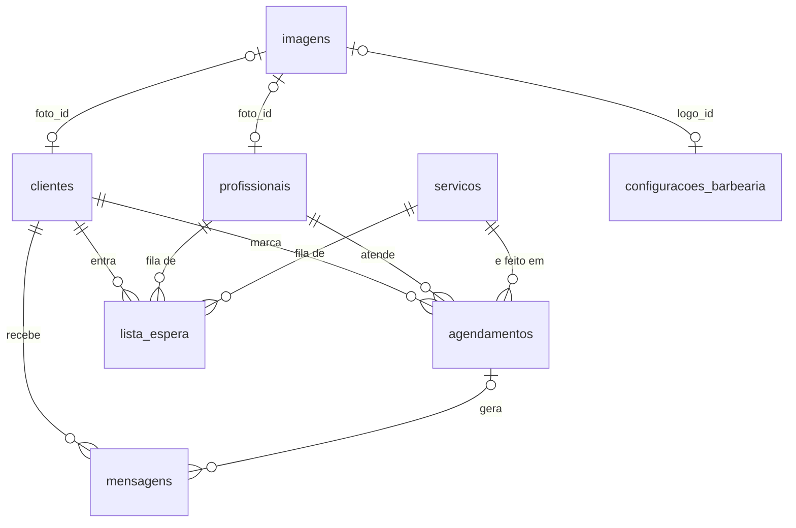

# BarberFlow — Agendamento online para barbearias

O BarberFlow substitui o agendamento por mensagem: o cliente escolhe serviço,
profissional, data e horário pelo site, recebe a confirmação na hora, é lembrado
2 horas antes e, se um horário vagar, quem estava na lista de espera é avisado.
O barbeiro acompanha tudo por um painel com agenda, faturamento do dia e
configurações da barbearia.

| | |
|---|---|
| **Frontend** | React 19 + Vite 7, React Router 7, Axios |
| **Backend** | Node.js + Express 5, Sequelize 6, node-cron |
| **Banco** | PostgreSQL |
| **APIs externas** | [ViaCEP](https://viacep.com.br) (endereço pelo CEP), [Nominatim/OpenStreetMap](https://nominatim.org) (endereço → coordenadas) e SMTP via [Nodemailer](https://nodemailer.com) (e-mails) |
| **Deploy** | Azure App Service (backend e frontend) via GitHub Actions |

---

## Sumário

- [Funcionalidades](#funcionalidades)
- [Estrutura do projeto](#estrutura-do-projeto)
- [Como rodar localmente](#como-rodar-localmente)
- [Variáveis de ambiente](#variáveis-de-ambiente)
- [Banco de dados](#banco-de-dados)
- [Imagens (logo e fotos de perfil)](#imagens-logo-e-fotos-de-perfil)
- [Barbearia mais próxima](#barbearia-mais-próxima)
- [Notificações por e-mail](#notificações-por-e-mail)
- [Rotas da API](#rotas-da-api)
- [Deploy](#deploy)
- [Limitações conhecidas e próximos passos](#limitações-conhecidas-e-próximos-passos)
- [Solução de problemas](#solução-de-problemas)

---

## Funcionalidades

### Área do cliente (`/cliente`)
- **Cadastro e login** com senha criptografada (bcrypt). O endereço é preenchido
  automaticamente pelo CEP (ViaCEP).
- **Barbearia mais próxima**: a Home pede a localização do navegador, calcula a
  distância até cada barbearia e destaca a mais perto, com botão de rota no
  Google Maps. Sem permissão de localização, usa o endereço cadastrado do cliente.
- **Agendamento**: o cliente escolhe a barbearia, abre a página dela (serviços,
  produtos, detalhes, avaliação) e agenda pelo modal: data → horário → barbeiro.
  Só aparecem dias de atendimento e horários realmente livres (expediente,
  duração do serviço e agendamentos já marcados são considerados).
- **Meus agendamentos**: próximos e histórico, com cancelamento e remarcação.
- **Lista de espera**: se o dia estiver lotado, o próprio modal oferece a fila.
- **Configurações**: dados pessoais, endereço pelo CEP (com rua e bairro
  digitáveis quando o CEP é da cidade toda), senha, tema e **foto de perfil**.

### Painel do barbeiro (`/dashboard`)
- **Dashboard** com lucro do dia e próximos agendamentos (dados reais da API).
- **Agenda** com os agendamentos do banco: concluir, remarcar e cancelar.
- **Configurações da barbearia**: nome, **logo**, telefone, endereço pelo CEP
  (que vira coordenadas para a busca por proximidade), dias e horário de
  funcionamento.
- **Notificações**: e-mail para novo agendamento, cancelamento, reagendamento,
  lembrete 2h antes e resumo do dia, cada um com liga/desliga, botão de
  e-mail de teste e histórico de envios.
- Clientes, serviços, produtos, financeiro e relatórios ainda usam dados de
  exemplo no frontend (ver [limitações](#limitações-conhecidas-e-próximos-passos)).

### Automações do backend
- **Confirmação imediata** por e-mail ao criar o agendamento.
- **Lembrete 2h antes**: job (`node-cron`) que roda a cada minuto e envia o
  lembrete uma única vez por agendamento (para o cliente e, se ligado, para a barbearia).
- **Resumo do dia** às 7h para a barbearia.
- **Aviso à lista de espera** quando um horário é cancelado ou remarcado.
- Tudo fica registrado (`mensagens` para clientes, `notificacoes_barbearia`
  para o barbeiro) com o resultado do envio: `enviado`, `simulado` (sem SMTP
  configurado) ou `falhou`.

---

## Estrutura do projeto

```
BarberFlow/
├── .github/workflows/          Deploy automático a cada push na main
├── barbearia-backend/
│   ├── config/sequelize.js     Conexão com o PostgreSQL (SSL automático fora do localhost)
│   ├── database/
│   │   ├── schema.sql          Modelo completo do banco, para consulta/documentação
│   │   └── seed.js             Serviços e profissionais de exemplo
│   ├── src/
│   │   ├── controllers/        Regras de cada recurso (clientes, agendamentos, imagens...)
│   │   ├── database/migrations.js  Migrações versionadas (rodam sozinhas ao subir)
│   │   ├── jobs/lembreteJob.js Lembrete 2h antes
│   │   ├── models/             Modelos Sequelize e relacionamentos (index.js)
│   │   ├── routes/             Rotas Express
│   │   ├── services/           ViaCEP, geocodificação, imagens, notificações
│   │   └── utils/
│   └── server.js
└── barbearia-frontend/
    ├── server.cjs              Servidor Express que entrega o build no Azure
    └── src/
        ├── data/barbearias.js  Catálogo exibido ao cliente (real + demonstração)
        ├── hooks/              useBarbearias, useConfiguracaoBarbearia, useLocalizacao
        ├── pages/              landingPage, auth, client/*, dashboardBarber/*
        ├── routes/             Rotas públicas, do cliente e do barbeiro
        ├── services/           Chamadas à API (axios)
        └── utils/              geo (distâncias), imagem (redimensionamento), telefone, tema
```

---

## Como rodar localmente

### Pré-requisitos
- Node.js 20 ou mais recente
- PostgreSQL 13 ou mais recente

### 1. Banco de dados
Crie um banco vazio (o nome padrão é `Barbearia_Cortae_DB`), pelo pgAdmin ou:

```bash
createdb -U postgres Barbearia_Cortae_DB
```

Não é preciso rodar nenhum SQL: ao subir, o backend cria as tabelas
(`sequelize.sync()`) e aplica as migrações pendentes.

### 2. Backend
```bash
cd barbearia-backend
npm install
cp .env.example .env      # ajuste usuário/senha do Postgres se necessário
npm run seed              # opcional: cria serviços e profissionais de exemplo
npm run dev
```

Saída esperada:
```
Conexão com o banco de dados estabelecida com sucesso.
Modelos sincronizados com o banco de dados.
[migração] aplicando 001_status_remarcado...
...
Job de lembretes (2h antes) iniciado.
Servidor rodando na porta 3000
```

### 3. Frontend
Em outro terminal:
```bash
cd barbearia-frontend
npm install
cp .env.example .env
npm run dev
```
Acesse `http://localhost:5173`.

### 4. Roteiro de teste
1. Em `/auth/barbeiro`, entre no painel e abra **Configurações**: defina nome,
   logo e o endereço (comece pelo CEP) e salve. Em **Notificações**, envie um
   e-mail de teste.
2. Em `/auth/cliente`, crie uma conta (informe o CEP) e faça login.
3. Na Home, permita o acesso à localização: a barbearia mais próxima aparece em
   destaque e a lista fica ordenada por distância.
4. Clique na barbearia, escolha um serviço e clique em **Agendar**: data,
   horário e barbeiro. Chega o e-mail de confirmação (ou, sem SMTP, aparece
   `[email:simulado]` no terminal).
5. Em **Configurações**, adicione uma foto de perfil.
6. Cancele o agendamento: se houver alguém na lista de espera daquele dia, ele é
   avisado (`[MENSAGEM:lista_espera]`). O barbeiro recebe o aviso de cancelamento.

---

## Variáveis de ambiente

### Backend (`barbearia-backend/.env`)

| Variável | Padrão | Descrição |
|---|---|---|
| `DB_NAME` | — | Nome do banco |
| `DB_USER` / `DB_PASSWORD` | — | Credenciais do PostgreSQL |
| `DB_HOST` / `DB_PORT` | `localhost` / `5432` | Endereço do banco |
| `DB_SSL` | automático | `true`/`false`. Se vazio, usa SSL só quando o banco não é local (o Azure exige) |
| `PORT` | `3000` | Porta da API |
| `GEOCODING_USER_AGENT` | `BarberFlow/1.0 (...)` | Identificação enviada ao Nominatim (a política de uso pede um contato) |
| `GEOCODING_DESABILITADO` | `false` | `true` desliga a geocodificação (útil em testes offline) |
| `SMTP_HOST` / `SMTP_PORT` | — / `587` | Servidor de e-mail. Ex.: `smtp.gmail.com` e `587` |
| `SMTP_USER` / `SMTP_PASS` | — | Login do e-mail (no Gmail, a **senha de app**) |
| `SMTP_FROM` | `SMTP_USER` | Endereço que aparece como remetente |
| `RESUMO_DIARIO_HORA` | `07:00` | Horário do resumo do dia (horário de Brasília) |

### Frontend (`barbearia-frontend/.env`)

| Variável | Descrição |
|---|---|
| `VITE_API_URL` | URL do backend. Local: `http://localhost:3000`. Produção: `.env.production` |

---

## Banco de dados

Modelo completo e comentado em [`barbearia-backend/database/schema.sql`](barbearia-backend/database/schema.sql).



| Tabela | Para que serve |
|---|---|
| `clientes` | Conta do cliente, endereço (ViaCEP), coordenadas do endereço, foto |
| `profissionais` | Barbeiros (podem ser desativados sem perder o histórico), foto |
| `servicos` | Nome, duração e preço |
| `agendamentos` | Quem, com quem, qual serviço, quando, status e **preço cobrado no dia** |
| `lista_espera` | Fila por profissional + serviço + dia |
| `mensagens` | Histórico de toda notificação enviada ao cliente, com o status do e-mail |
| `notificacoes_barbearia` | Histórico dos avisos enviados ao barbeiro (aparece na aba Notificações) |
| `configuracoes_barbearia` | Linha única (`id = 1`) com os dados da barbearia, logo e coordenadas |
| `imagens` | Arquivos de imagem (logo e fotos) em binário |
| `schema_migrations` | Controle das migrações já aplicadas |

Decisões importantes:
- **Histórico protegido**: apagar cliente, profissional ou serviço com
  agendamentos é bloqueado (`ON DELETE RESTRICT`). Profissionais e serviços têm o
  campo `ativo` para serem desativados.
- **`preco_cobrado`** guarda o valor no momento do agendamento, então mudar o
  preço de um serviço não altera o faturamento de dias passados.
- **Datas de registro** (`criado_em` / `atualizado_em`) em clientes,
  profissionais, serviços e agendamentos; `criado_em` na lista de espera.
- **E-mails sempre em minúsculo**, evitando contas duplicadas como
  `Joao@x.com` e `joao@x.com`.

### Migrações
O `sequelize.sync()` cria tabelas novas, mas não altera tabelas que já existem.
Por isso, mudanças de estrutura ficam em `src/database/migrations.js`: cada
migração roda uma única vez e fica registrada em `schema_migrations`. Para
alterar o banco, acrescente uma nova migração no fim da lista. Elas usam
`IF NOT EXISTS` e funcionam tanto em banco novo quanto no banco que já está em produção.

| Migração | O que faz |
|---|---|
| 001–002 | Status `remarcado` e mensagem do tipo `remarcacao` |
| 003 | Coluna `preco_cobrado` (preenchida com o preço atual nos agendamentos antigos) |
| 004 | Chaves estrangeiras de agendamentos com `RESTRICT` |
| 005 | Checks de preço e duração |
| 006 | Índices de agenda, cliente, lista de espera e mensagens |
| 007 | Tabela `imagens`, colunas `foto_id`/`logo_id` e coordenadas; move a logo antiga (base64) para `imagens` |
| 008 | `criado_em`/`atualizado_em` e índices do job de lembretes |
| 009 | Normaliza e-mails para minúsculo |
| 010 | Status do envio nas mensagens e tabela `notificacoes_barbearia` |
| 011 | Mensagem do tipo `cancelamento` |

---

## Imagens (logo e fotos de perfil)

1. O usuário escolhe o arquivo (PNG, JPG, WEBP ou GIF, até 5 MB).
2. O **navegador** reduz a imagem para no máximo 256 px (`src/utils/imagem.js`)
   e envia como data URL.
3. O **backend** (`src/services/imagemService.js`) confere o tipo real pelos
   primeiros bytes do arquivo, limita a 512 KB e grava o binário na tabela
   `imagens`, com id UUID (não dá para chegar à imagem de outra pessoa trocando
   um número na URL).
4. Clientes, profissionais e a barbearia guardam só a referência (`foto_id` /
   `logo_id`). A API devolve `foto_url` / `logo_url` (`/imagens/<id>`).
5. `GET /imagens/:id` entrega o arquivo com cache de 1 ano. Cada envio gera um
   id novo, então trocar a foto nunca mostra a versão antiga em cache. A imagem
   anterior é apagada na mesma transação.

**Por que no banco?** No Azure App Service o disco do app é recriado a cada
deploy, então arquivos salvos numa pasta se perderiam. Com as imagens já
reduzidas (dezenas de KB), o PostgreSQL dá conta sem infraestrutura extra.
**Se o volume crescer**, basta trocar o `imagemService` para gravar no
**Azure Blob Storage** (ou S3/Cloudinary) e guardar a URL. O resto do sistema
não muda, porque todos já usam `foto_url`/`logo_url`.

---

## Barbearia mais próxima

```
Configurações da barbearia (endereço) ─► backend geocodifica (Nominatim) ─► latitude/longitude no banco
                                                                                     │
Navegador do cliente ─► navigator.geolocation ─► posição atual ─► distância (Haversine) ─► lista ordenada + destaque
                        (negou? usa as coordenadas do endereço cadastrado do cliente)
```

- **Coordenadas da barbearia**: ao salvar as Configurações com um endereço novo,
  o backend consulta o Nominatim (OpenStreetMap, gratuito e sem chave), tentando
  rua + número, depois o endereço por extenso, o CEP e por fim a cidade. O
  resultado precisa ser do mesmo estado do cadastro (evita confundir, por
  exemplo, Paulo Frontin/PR com Engenheiro Paulo de Frontin/RJ). Se não
  encontrar, o painel avisa; se o mapa estiver fora do ar, o backend tenta de
  novo sozinho depois.
- **Links do Google Maps** usam o endereço escrito (rua, número, cidade, CEP),
  que o Google localiza melhor do que coordenadas aproximadas.
- **Posição do cliente**: o hook `useLocalizacao` pede a localização ao
  navegador. Funciona em `https://` e em `localhost`. Se o cliente negar, o
  sistema usa as coordenadas do endereço cadastrado (calculadas a partir do CEP).
- **Cálculo**: `src/utils/geo.js` usa a fórmula de Haversine (distância em linha
  reta). Barbearias sem coordenadas aparecem no fim da lista.
- O botão **Como chegar** abre a rota no Google Maps a partir da posição do cliente.

---

## Notificações por e-mail

O backend envia e-mails por **SMTP** com o Nodemailer. Funciona com Gmail,
Outlook, Brevo, Mailtrap ou qualquer outro provedor SMTP. Não precisa de API
paga nem de domínio próprio.

| Para quem | Quando | Pode desligar? |
|---|---|---|
| Cliente | Confirmação, remarcação, cancelamento, lembrete 2h antes, vaga na lista de espera | Não (faz parte do agendamento) |
| Barbearia | Novo agendamento, cancelamento, reagendamento, lembrete 2h antes, resumo do dia | Sim, na aba **Notificações** |

Os e-mails da barbearia vão para o **Email para Notificações** (ou, se estiver
vazio, para o email principal da barbearia).

### Passo a passo com Gmail
1. Na conta Google que vai **enviar** os e-mails, ative a
   [verificação em duas etapas](https://myaccount.google.com/signinoptions/two-step-verification).
2. Crie uma senha de app em <https://myaccount.google.com/apppasswords>
   (nome: "BarberFlow"). O Google mostra uma senha de 16 letras.
3. No `barbearia-backend/.env`, adicione:
   ```env
   SMTP_HOST=smtp.gmail.com
   SMTP_PORT=587
   SMTP_USER=seuemail@gmail.com
   SMTP_PASS=abcdefghijklmnop   # a senha de app, sem espaços
   SMTP_FROM=seuemail@gmail.com
   ```
4. Reinicie o backend (`npm run dev`).
5. No painel do barbeiro, abra **Configurações → Notificações**, preencha o
   **Email para Notificações**, ligue o que quiser receber e clique em
   **Salvar Preferências**.
6. Clique em **Enviar e-mail de teste**. O resultado aparece na hora e o envio
   entra em **Últimas Notificações**. Se o e-mail não chegar, olhe a pasta de spam.
7. No Azure, cadastre as mesmas variáveis `SMTP_*` em
   *Configuration → Application settings* do backend.

Sem `SMTP_*` configurado, o sistema continua funcionando: as notificações são
registradas como **simuladas** e aparecem no console (`[email:simulado]`).

> O Gmail permite cerca de 500 e-mails por dia, mais do que suficiente para uma
> barbearia. Para volumes maiores, use um provedor transacional (Brevo, por
> exemplo, tem SMTP gratuito): só mudam as variáveis `SMTP_*`.

---

## Rotas da API

Base local: `http://localhost:3000`

### Clientes
| Método | Rota | Descrição |
|---|---|---|
| POST | `/clientes` | Cadastra (endereço completado pelo CEP; coordenadas calculadas em segundo plano) |
| POST | `/clientes/login` | Login |
| GET | `/clientes` · `/clientes/:id` | Lista / busca (nunca devolve a senha) |
| PUT | `/clientes/:id` | Atualiza dados; troca de CEP recalcula endereço e coordenadas |
| DELETE | `/clientes/:id` | Exclui (bloqueado se houver agendamentos) |
| PUT | `/clientes/:id/foto` | Envia foto de perfil — corpo `{ "imagem": "data:image/png;base64,..." }` |
| DELETE | `/clientes/:id/foto` | Remove a foto |
| GET | `/cep/:cep` | Consulta de endereço por CEP |

### Profissionais e serviços
| Método | Rota | Descrição |
|---|---|---|
| POST · GET · PUT · DELETE | `/profissionais[/:id]` | CRUD de profissionais |
| PUT · DELETE | `/profissionais/:id/foto` | Foto do profissional |
| POST · GET · PUT · DELETE | `/servicos[/:id]` | CRUD de serviços |

### Agendamentos, lista de espera e mensagens
| Método | Rota | Descrição |
|---|---|---|
| POST | `/agendamentos` | Cria (verifica expediente e conflito, envia a confirmação) |
| GET | `/disponibilidade?data=AAAA-MM-DD&servico_id=` | Horários livres do dia, com os barbeiros livres em cada um |
| GET | `/agendamentos?cliente_id=&profissional_id=&status=` | Lista com filtros |
| GET | `/agendamentos/:id` | Detalhe |
| PUT | `/agendamentos/:id` | Remarca |
| PATCH | `/agendamentos/:id/concluir` | Marca como concluído |
| DELETE | `/agendamentos/:id` | Cancela e avisa a lista de espera |
| POST · GET · DELETE | `/lista-espera[/:id]` | Entrar, listar e sair da fila |
| GET | `/mensagens?cliente_id=&tipo=` | Histórico de notificações |

### Barbearia e imagens
| Método | Rota | Descrição |
|---|---|---|
| GET | `/configuracoes` | Dados da barbearia, incluindo `logo_url`, `latitude` e `longitude` |
| PUT | `/configuracoes` | Salva. Campo `logo`: data URL = nova logo · URL atual = manter · `null` = remover. Responde `localizacao_encontrada` |
| GET | `/imagens/:id` | Arquivo da imagem |
| GET | `/configuracoes/notificacoes/status` | Se o SMTP está configurado e para qual e-mail vão os avisos |
| POST | `/configuracoes/notificacoes/teste` | Envia um e-mail de teste para a barbearia |
| GET | `/notificacoes-barbearia?limite=` | Últimas notificações enviadas para a barbearia |

---

## Deploy

Cada push na `main` dispara os workflows de `.github/workflows/`:
- `main_barberflow-backend.yml` publica a API no Azure App Service.
- `main_barberflow-frontend.yml` gera o build (usando `.env.production`) e
  publica o frontend no Azure, servido pelo `server.cjs`.
- `deploy.yaml` publica o build do frontend no GitHub Pages.

No Azure, configure as variáveis do backend (`DB_*` e, se quiser,
`GEOCODING_USER_AGENT`) em *Configuration → Application settings*. As migrações
rodam sozinhas na primeira inicialização depois do deploy.

---

## Limitações conhecidas e próximos passos

- **Uma barbearia real por instalação**: os dados da barbearia ficam em
  `configuracoes_barbearia` (linha única). As outras barbearias que o cliente vê
  são de **demonstração** (`src/data/barbearias.js`, com coordenadas fixas) e não
  gravam agendamentos. Para virar uma plataforma com várias barbearias, o passo é
  criar a tabela `barbearias` e ligar profissionais, serviços e agendamentos a ela
  (`barbearia_id`). Aí a busca por proximidade pode ir para o backend
  (`GET /barbearias/proximas?lat=&lng=`).
- **Autenticação**: o login devolve os dados do cliente, mas a API ainda não usa
  token, então as rotas `/clientes/:id` não conferem quem está chamando.
  Próximo passo: JWT no login e um middleware que verifica se o `:id` é do
  usuário logado.
- **Login do barbeiro** ainda é simulado no frontend.
- **Telas do painel com dados de exemplo**: clientes, serviços, produtos,
  financeiro e relatórios.
- **WhatsApp/SMS**: as notificações saem por e-mail. Para WhatsApp seria
  preciso a API oficial (Meta WhatsApp Cloud API ou Twilio), com conta
  comercial verificada; o ponto de troca é o `notificacaoService`.

---

## Solução de problemas

- **"Não foi possível conectar ao banco de dados"**: confira se o PostgreSQL está
  rodando e se o `.env` do backend tem as credenciais certas.
- **API responde `503 Backend iniciou com erro`**: o servidor subiu, mas o banco
  ou uma migração falhou. O campo `detalhe` da resposta e o log mostram o motivo.
- **Tela de agendamento vazia**: rode `npm run seed` no backend.
- **Erro de CORS**: confira se `VITE_API_URL` aponta para o backend que está rodando.
- **CEP não preenche o endereço / barbearia não aparece como "mais próxima"**:
  ViaCEP e Nominatim precisam de acesso à internet (`viacep.com.br` e
  `nominatim.openstreetmap.org`). Depois, salve de novo o endereço nas
  Configurações da barbearia.
- **O navegador não pede a localização**: a geolocalização só funciona em
  `https://` ou `localhost`. Se o acesso foi negado antes, libere no ícone de
  cadeado da barra de endereço.
