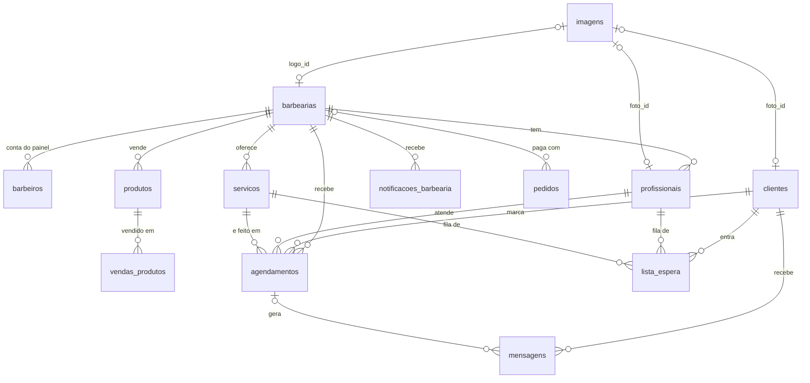

# BarberFlow — Agendamento online para barbearias

O BarberFlow substitui o agendamento por mensagem: o cliente escolhe serviço,
profissional, data e horário pelo site, recebe a confirmação na hora, é lembrado
2 horas antes e, se um horário vagar, quem estava na lista de espera é avisado.
O barbeiro acompanha tudo por um painel com agenda, faturamento do dia e
configurações da barbearia.

É uma plataforma com **várias barbearias**: o dono compra um plano na Home,
paga pelo **Mercado Pago** e recebe por e-mail o login do painel da barbearia
dele. Os clientes veem todas as barbearias com assinatura ativa.

| | |
|---|---|
| **Frontend** | React 19 + Vite 7, React Router 7, Axios |
| **Backend** | Node.js + Express 5, Sequelize 6, node-cron |
| **Banco** | PostgreSQL |
| **APIs externas** | [Mercado Pago Checkout Pro](https://www.mercadopago.com.br/developers/pt/docs/checkout-pro/landing) (venda dos planos), [ViaCEP](https://viacep.com.br) (endereço pelo CEP), [Nominatim/OpenStreetMap](https://nominatim.org) (endereço → coordenadas) e SMTP via [Nodemailer](https://nodemailer.com) (e-mails) |
| **Deploy** | Azure App Service (backend e frontend) via GitHub Actions |

---

## Sumário

- [Funcionalidades](#funcionalidades)
- [Estrutura do projeto](#estrutura-do-projeto)
- [Como rodar localmente](#como-rodar-localmente)
- [Variáveis de ambiente](#variáveis-de-ambiente)
- [Banco de dados](#banco-de-dados)
- [Imagens (logo e fotos de perfil)](#imagens-logo-e-fotos-de-perfil)
- [Barbearia mais próxima](#barbearia-mais-próxima)
- [Notificações por e-mail](#notificações-por-e-mail)
- [Planos e pagamento (Mercado Pago)](#planos-e-pagamento-mercado-pago)
- [Contato com o suporte](#contato-com-o-suporte)
- [Segurança](#segurança)
- [Zerar o banco de dados](#zerar-o-banco-de-dados)
- [Rotas da API](#rotas-da-api)
- [Deploy](#deploy)
- [Limitações conhecidas e próximos passos](#limitações-conhecidas-e-próximos-passos)
- [Solução de problemas](#solução-de-problemas)

---

## Funcionalidades

### Home (`/`)
- **Planos**: o botão **Adquirir** de cada plano abre o checkout (`/assinar/:plano`).
  O dono informa nome, e-mail, nome da barbearia e telefone e vai para o
  **Mercado Pago** (Pix, cartão ou boleto). Pagamento aprovado = barbearia
  criada e **e-mail com login e senha temporária** do painel.
- **Entre em contato**: nome, e-mail, perfil (cliente ou barbeiro), assunto e
  mensagem vão por e-mail para o suporte (`SUPORTE_EMAIL`), que responde direto
  para quem escreveu.

### Área do cliente (`/cliente`)
- **Cadastro e login** com senha criptografada (bcrypt). O endereço é preenchido
  automaticamente pelo CEP (ViaCEP).
- **Barbearia mais próxima**: a Home pede a localização do navegador, calcula a
  distância até cada barbearia e destaca a mais perto, com botão de rota no
  Google Maps. Sem permissão de localização, usa o endereço cadastrado do cliente.
- **Várias barbearias**: todas as que têm assinatura ativa aparecem para o
  cliente, cada uma com os próprios serviços, barbeiros e horários. Não há
  barbearias fictícias: a lista começa vazia e cresce com as assinaturas.
- **Agendamento**: o cliente escolhe a barbearia, abre a página dela (serviços,
  produtos, detalhes, avaliação) e agenda pelo modal: data → horário → barbeiro.
  Só aparecem dias de atendimento e horários realmente livres (expediente,
  duração do serviço e agendamentos já marcados são considerados).
- **Meus agendamentos**: próximos e histórico, com cancelamento e remarcação.
- **Lista de espera**: se o dia estiver lotado, o próprio modal oferece a fila.
- **Configurações**: dados pessoais, endereço pelo CEP (com rua e bairro
  digitáveis quando o CEP é da cidade toda), senha, tema e **foto de perfil**.

### Painel do barbeiro (`/dashboard`)
- **Dashboard** com lucro do dia e próximos agendamentos (dados reais da API).
- **Agenda** com os agendamentos do banco: concluir, remarcar e cancelar.
- **Configurações da barbearia**: nome, **logo**, telefone, endereço pelo CEP
  (que vira coordenadas para a busca por proximidade), dias e horário de
  funcionamento.
- **Notificações**: e-mail para novo agendamento, cancelamento, reagendamento,
  lembrete 2h antes e resumo do dia, cada um com liga/desliga, botão de
  e-mail de teste e histórico de envios.
- **Conta e plano**: troca de senha (obrigatória no primeiro acesso, com a senha
  temporária do e-mail), plano atual, vencimento, renovar ou mudar de plano e
  histórico de pagamentos.
- Cada barbeiro só enxerga e altera os dados da **própria** barbearia.
- **Serviços** e **Barbeiros**: cadastro, edição, foto, ativar/desativar e
  exclusão, gravados no banco (o que o cliente vê na página da barbearia). O
  número de barbeiros ativos respeita o limite do plano.
- **Clientes**: quem já agendou na barbearia, com total gasto, visitas,
  cancelamentos, serviço preferido, próximo horário e histórico completo
  (o cadastro é do próprio cliente; o barbeiro só acompanha).
- **Produtos**: cadastro com preço, custo e estoque, alertas de estoque baixo e
  **registro de venda** no balcão (baixa o estoque e entra no Financeiro).
- **Financeiro** e **Relatórios** (com PDF): calculados dos atendimentos
  **concluídos** na Agenda e das vendas de produtos: faturamento, ticket médio,
  a receber, clientes, horários de pico, situação dos agendamentos e comparação
  com o período anterior. Nada é inventado: sem atendimentos, os números ficam zerados.

### Automações do backend
- **Confirmação imediata** por e-mail ao criar o agendamento.
- **Lembrete 2h antes**: job (`node-cron`) que roda a cada minuto e envia o
  lembrete uma única vez por agendamento (para o cliente e, se ligado, para a barbearia).
- **Resumo do dia** às 7h para cada barbearia.
- **Pedidos de plano** não pagos em 3 dias viram `cancelado`.
- **Aviso à lista de espera** quando um horário é cancelado ou remarcado.
- Tudo fica registrado (`mensagens` para clientes, `notificacoes_barbearia`
  para o barbeiro) com o resultado do envio: `enviado`, `simulado` (sem SMTP
  configurado) ou `falhou`.

---

## Estrutura do projeto

```
BarberFlow/
├── .github/workflows/          Deploy automático a cada push na main
├── barbearia-backend/
│   ├── config/sequelize.js     Conexão com o PostgreSQL (SSL automático fora do localhost)
│   ├── database/
│   │   ├── schema.sql          Modelo completo do banco, para consulta/documentação
│   │   ├── seed.js             Serviços e profissionais de exemplo
│   │   ├── criar-admin.js      Cria/redefine a conta do painel do barbeiro
│   │   └── reset.js            Apaga todos os dados (pede confirmação)
│   ├── src/
│   │   ├── controllers/        Regras de cada recurso (clientes, agendamentos, imagens...)
│   │   ├── database/migrations.js  Migrações versionadas (rodam sozinhas ao subir)
│   │   ├── jobs/lembreteJob.js Lembrete 2h antes
│   │   ├── middlewares/        Autenticação (JWT), permissões, limites e cabeçalhos de segurança
│   │   ├── models/             Modelos Sequelize e relacionamentos (index.js)
│   │   ├── routes/             Rotas Express
│   │   ├── services/           ViaCEP, geocodificação, imagens, notificações, Mercado Pago, assinaturas
│   │   └── utils/              planos.js (preços e limites dos planos), senha...
│   └── server.js
└── barbearia-frontend/
    ├── server.cjs              Servidor Express que entrega o build no Azure
    └── src/
        ├── data/               barbearias.js (barbearias da API), planos.js
        ├── hooks/              useBarbearias, useConfiguracaoBarbearia, useLocalizacao
        ├── pages/              landingPage, checkout, auth, client/*, dashboardBarber/*
        ├── routes/             Rotas públicas, do cliente e do barbeiro
        ├── services/           Chamadas à API (axios)
        └── utils/              geo (distâncias), imagem (redimensionamento), telefone, tema
```

---

## Como rodar localmente

### Pré-requisitos
- Node.js 20 ou mais recente
- PostgreSQL 13 ou mais recente

### 1. Banco de dados
Crie um banco vazio (o nome padrão é `Barbearia_Cortae_DB`), pelo pgAdmin ou:

```bash
createdb -U postgres Barbearia_Cortae_DB
```

Não é preciso rodar nenhum SQL: ao subir, o backend cria as tabelas
(`sequelize.sync()`) e aplica as migrações pendentes.

### 2. Backend
```bash
cd barbearia-backend
npm install
cp .env.example .env      # ajuste usuário/senha do Postgres e preencha JWT_SECRET
npm run criar-admin       # cria uma barbearia + conta do painel (sem passar pelo pagamento)
npm run seed              # opcional: cria serviços e profissionais de exemplo
npm run dev
```

Saída esperada:
```
Conexão com o banco de dados estabelecida com sucesso.
Modelos sincronizados com o banco de dados.
[migração] aplicando 001_status_remarcado...
...
Job de lembretes (2h antes) iniciado.
Servidor rodando na porta 3000
```

### 3. Frontend
Em outro terminal:
```bash
cd barbearia-frontend
npm install
cp .env.example .env
npm run dev
```
Acesse `http://localhost:5173`.

### 4. Roteiro de teste
1. Na Home, clique em **Adquirir** em um plano, preencha os dados e pague
   (com credenciais de teste do Mercado Pago, ou com `PAGAMENTO_SIMULADO=true`
   para um pagamento de mentira). Chega o e-mail com login e senha temporária
   (sem SMTP, a senha aparece no terminal do backend).
2. Em **Área do Barbeiro**, entre com esses dados: o painel abre em
   **Configurações → Conta e plano** para criar a senha definitiva. Depois, em
   **Perfil da Empresa**, defina nome, logo e endereço (comece pelo CEP) e, em
   **Serviços** e **Barbeiros**, cadastre o que a barbearia oferece.
3. Em `/auth/cliente`, crie uma conta (informe o CEP) e faça login.
4. Na Home do cliente, permita o acesso à localização: a barbearia mais próxima aparece em
   destaque e a lista fica ordenada por distância.
5. Clique na barbearia, escolha um serviço e clique em **Agendar**: data,
   horário e barbeiro. Chega o e-mail de confirmação (ou, sem SMTP, aparece
   `[email:simulado]` no terminal).
6. Em **Configurações**, adicione uma foto de perfil.
7. Na Home, envie uma mensagem em **Entre em contato**: ela chega no `SUPORTE_EMAIL`.
8. Cancele o agendamento: se houver alguém na lista de espera daquele dia, ele é
   avisado (`[MENSAGEM:lista_espera]`). O barbeiro recebe o aviso de cancelamento.

---

## Variáveis de ambiente

### Backend (`barbearia-backend/.env`)

| Variável | Padrão | Descrição |
|---|---|---|
| `DB_NAME` | — | Nome do banco |
| `DB_USER` / `DB_PASSWORD` | — | Credenciais do PostgreSQL |
| `DB_HOST` / `DB_PORT` | `localhost` / `5432` | Endereço do banco |
| `DB_SSL` | automático | `true`/`false`. Se vazio, usa SSL só quando o banco não é local (o Azure exige) |
| `PORT` | `3000` | Porta da API |
| `GEOCODING_USER_AGENT` | `BarberFlow/1.0 (...)` | Identificação enviada ao Nominatim (a política de uso pede um contato) |
| `GEOCODING_DESABILITADO` | `false` | `true` desliga a geocodificação (útil em testes offline) |
| `SMTP_HOST` / `SMTP_PORT` | — / `587` | Servidor de e-mail. Ex.: `smtp.gmail.com` e `587` |
| `SMTP_USER` / `SMTP_PASS` | — | Login do e-mail (no Gmail, a **senha de app**) |
| `SMTP_FROM` | `SMTP_USER` | Endereço que aparece como remetente |
| `RESUMO_DIARIO_HORA` | `07:00` | Horário do resumo do dia (horário de Brasília) |
| `JWT_SECRET` | — | **Obrigatório em produção.** Segredo dos tokens de login (mín. 32 caracteres) |
| `CORS_ORIGINS` | localhost + Azure + GitHub Pages | Sites que podem chamar a API pelo navegador (separados por vírgula) |
| `TRUST_PROXY` | `1` no Azure, `0` fora | Quantos proxies existem na frente da API (para o limite de tentativas usar o IP real) |
| `SUPORTE_EMAIL` | `SMTP_USER` | Caixa que recebe o formulário "Entre em contato" (ex.: `barberflow@gmail.com`) |
| `MP_ACCESS_TOKEN` | — | Access Token do Mercado Pago (de teste ou de produção). Sem ele a compra de planos fica indisponível |
| `MP_WEBHOOK_SECRET` | — | Assinatura secreta dos webhooks do Mercado Pago (confere que o aviso veio mesmo deles) |
| `FRONTEND_URL` | `http://localhost:5173` | Endereço do site: volta do pagamento e link do e-mail com o login |
| `BACKEND_URL` | `WEBSITE_HOSTNAME` no Azure | Endereço público da API, para o Mercado Pago avisar do pagamento (só https) |
| `PAGAMENTO_SIMULADO` | `false` | `true` = demonstração sem Mercado Pago (ignorado em produção) |

### Frontend (`barbearia-frontend/.env`)

| Variável | Descrição |
|---|---|
| `VITE_API_URL` | URL do backend. Local: `http://localhost:3000`. Produção: `.env.production` |

---

## Banco de dados

Modelo completo e comentado em [`barbearia-backend/database/schema.sql`](barbearia-backend/database/schema.sql).



| Tabela | Para que serve |
|---|---|
| `barbearias` | Uma por compra: dados, logo, coordenadas, horários, notificações e **assinatura** (`plano`, `status`, `assinatura_expira_em`) |
| `barbeiros` | Contas do painel (o dono que faz login); cada uma é de uma barbearia. `senha_temporaria` = ainda não trocou a senha do e-mail. Antes se chamava `administradores` |
| `produtos` | Produtos de balcão da barbearia: preço, custo, estoque, categoria |
| `vendas_produtos` | Cada venda registrada (quantidade, preço e custo do momento) |
| `pedidos` | Compras de plano no Mercado Pago (pendente → aprovado/recusado/cancelado) |
| `contatos` | Cópia das mensagens do "Entre em contato" |
| `clientes` | Conta do cliente, endereço (ViaCEP), coordenadas do endereço, foto |
| `profissionais` | Barbeiros que atendem e aparecem no agendamento (podem ser desativados sem perder o histórico), foto |
| `servicos` | Nome, duração e preço |
| `agendamentos` | Quem, com quem, qual serviço, quando, status e **preço cobrado no dia** |
| `lista_espera` | Fila por profissional + serviço + dia |
| `mensagens` | Histórico de toda notificação enviada ao cliente, com o status do e-mail |
| `notificacoes_barbearia` | Histórico dos avisos enviados ao barbeiro (aparece na aba Notificações) |
| `imagens` | Arquivos de imagem (logo e fotos) em binário |
| `schema_migrations` | Controle das migrações já aplicadas |

Decisões importantes:
- **Multi-barbearia**: profissionais, serviços, agendamentos, lista de espera e
  notificações têm `barbearia_id`; toda consulta do painel é filtrada pela
  barbearia do barbeiro logado. Clientes são da plataforma (agendam em qualquer uma).
- **Histórico protegido**: apagar cliente, profissional ou serviço com
  agendamentos é bloqueado (`ON DELETE RESTRICT`). Profissionais e serviços têm o
  campo `ativo` para serem desativados.
- **`preco_cobrado`** guarda o valor no momento do agendamento, então mudar o
  preço de um serviço não altera o faturamento de dias passados.
- **Datas de registro** (`criado_em` / `atualizado_em`) em clientes,
  profissionais, serviços e agendamentos; `criado_em` na lista de espera.
- **E-mails sempre em minúsculo**, evitando contas duplicadas como
  `Joao@x.com` e `joao@x.com`.

### Migrações
O `sequelize.sync()` cria tabelas novas, mas não altera tabelas que já existem.
Por isso, mudanças de estrutura ficam em `src/database/migrations.js`: cada
migração roda uma única vez e fica registrada em `schema_migrations`. Para
alterar o banco, acrescente uma nova migração no fim da lista. Elas usam
`IF NOT EXISTS` e funcionam tanto em banco novo quanto no banco que já está em produção.

| Migração | O que faz |
|---|---|
| 001–002 | Status `remarcado` e mensagem do tipo `remarcacao` |
| 003 | Coluna `preco_cobrado` (preenchida com o preço atual nos agendamentos antigos) |
| 004 | Chaves estrangeiras de agendamentos com `RESTRICT` |
| 005 | Checks de preço e duração |
| 006 | Índices de agenda, cliente, lista de espera e mensagens |
| 007 | Tabela `imagens`, colunas `foto_id`/`logo_id` e coordenadas; move a logo antiga (base64) para `imagens` |
| 008 | `criado_em`/`atualizado_em` e índices do job de lembretes |
| 009 | Normaliza e-mails para minúsculo |
| 010 | Status do envio nas mensagens e tabela `notificacoes_barbearia` |
| 011 | Mensagem do tipo `cancelamento` |
| 012 | Contas do painel e `token_versao` dos clientes |
| 013 | Várias barbearias: `configuracoes_barbearia` vira `barbearias` (a barbearia que já existia vira a nº 1, plano Enterprise), `barbearia_id` em todas as tabelas, `senha_temporaria` |
| 014 | A tabela `administradores` passa a se chamar `barbeiros` (contas e senhas mantidas) |

---

## Imagens (logo e fotos de perfil)

1. O usuário escolhe o arquivo (PNG, JPG, WEBP ou GIF, até 5 MB).
2. O **navegador** reduz a imagem para no máximo 256 px (`src/utils/imagem.js`)
   e envia como data URL.
3. O **backend** (`src/services/imagemService.js`) confere o tipo real pelos
   primeiros bytes do arquivo, limita a 512 KB e grava o binário na tabela
   `imagens`, com id UUID (não dá para chegar à imagem de outra pessoa trocando
   um número na URL).
4. Clientes, profissionais e a barbearia guardam só a referência (`foto_id` /
   `logo_id`). A API devolve `foto_url` / `logo_url` (`/imagens/<id>`).
5. `GET /imagens/:id` entrega o arquivo com cache de 1 ano. Cada envio gera um
   id novo, então trocar a foto nunca mostra a versão antiga em cache. A imagem
   anterior é apagada na mesma transação.

**Por que no banco?** No Azure App Service o disco do app é recriado a cada
deploy, então arquivos salvos numa pasta se perderiam. Com as imagens já
reduzidas (dezenas de KB), o PostgreSQL dá conta sem infraestrutura extra.
**Se o volume crescer**, basta trocar o `imagemService` para gravar no
**Azure Blob Storage** (ou S3/Cloudinary) e guardar a URL. O resto do sistema
não muda, porque todos já usam `foto_url`/`logo_url`.

---

## Barbearia mais próxima

```
Configurações da barbearia (endereço) ─► backend geocodifica (Nominatim) ─► latitude/longitude no banco
                                                                                     │
Navegador do cliente ─► navigator.geolocation ─► posição atual ─► distância (Haversine) ─► lista ordenada + destaque
                        (negou? usa as coordenadas do endereço cadastrado do cliente)
```

- **Coordenadas da barbearia**: ao salvar as Configurações com um endereço novo,
  o backend consulta o Nominatim (OpenStreetMap, gratuito e sem chave), tentando
  rua + número, depois o endereço por extenso, o CEP e por fim a cidade. O
  resultado precisa ser do mesmo estado do cadastro (evita confundir, por
  exemplo, Paulo Frontin/PR com Engenheiro Paulo de Frontin/RJ). Se não
  encontrar, o painel avisa; se o mapa estiver fora do ar, o backend tenta de
  novo sozinho depois.
- **Links do Google Maps** usam o endereço escrito (rua, número, cidade, CEP),
  que o Google localiza melhor do que coordenadas aproximadas.
- **Posição do cliente**: o hook `useLocalizacao` pede a localização ao
  navegador. Funciona em `https://` e em `localhost`. Se o cliente negar, o
  sistema usa as coordenadas do endereço cadastrado (calculadas a partir do CEP).
- **Cálculo**: `src/utils/geo.js` usa a fórmula de Haversine (distância em linha
  reta). Barbearias sem coordenadas aparecem no fim da lista.
- O botão **Como chegar** abre a rota no Google Maps a partir da posição do cliente.

---

## Notificações por e-mail

O backend envia e-mails por **SMTP** com o Nodemailer. Funciona com Gmail,
Outlook, Brevo, Mailtrap ou qualquer outro provedor SMTP. Não precisa de API
paga nem de domínio próprio.

| Para quem | Quando | Pode desligar? |
|---|---|---|
| Cliente | Confirmação, remarcação, cancelamento, lembrete 2h antes, vaga na lista de espera | Não (faz parte do agendamento) |
| Barbearia | Novo agendamento, cancelamento, reagendamento, lembrete 2h antes, resumo do dia | Sim, na aba **Notificações** |

Os e-mails da barbearia vão para o **Email para Notificações** (ou, se estiver
vazio, para o email principal da barbearia).

### Passo a passo com Gmail
1. Na conta Google que vai **enviar** os e-mails, ative a
   [verificação em duas etapas](https://myaccount.google.com/signinoptions/two-step-verification).
2. Crie uma senha de app em <https://myaccount.google.com/apppasswords>
   (nome: "BarberFlow"). O Google mostra uma senha de 16 letras.
3. No `barbearia-backend/.env`, adicione:
   ```env
   SMTP_HOST=smtp.gmail.com
   SMTP_PORT=587
   SMTP_USER=seuemail@gmail.com
   SMTP_PASS=abcdefghijklmnop   # a senha de app, sem espaços
   SMTP_FROM=seuemail@gmail.com
   ```
4. Reinicie o backend (`npm run dev`).
5. No painel do barbeiro, abra **Configurações → Notificações**, preencha o
   **Email para Notificações**, ligue o que quiser receber e clique em
   **Salvar Preferências**.
6. Clique em **Enviar e-mail de teste**. O resultado aparece na hora e o envio
   entra em **Últimas Notificações**. Se o e-mail não chegar, olhe a pasta de spam.
7. No Azure, cadastre as mesmas variáveis `SMTP_*` em
   *Configuration → Application settings* do backend.

Sem `SMTP_*` configurado, o sistema continua funcionando: as notificações são
registradas como **simuladas** e aparecem no console (`[email:simulado]`).

> O Gmail permite cerca de 500 e-mails por dia, mais do que suficiente para uma
> barbearia. Para volumes maiores, use um provedor transacional (Brevo, por
> exemplo, tem SMTP gratuito): só mudam as variáveis `SMTP_*`.

---

## Planos e pagamento (Mercado Pago)

Fluxo de compra:

```
Home "Adquirir" → /assinar/:plano (dados) → POST /assinaturas/checkout
   → Mercado Pago (Pix, cartão, boleto) → volta para /assinar/retorno
   → backend confere o pagamento NO Mercado Pago → cria barbearia + conta
   → e-mail com login e senha temporária → login em "Área do Barbeiro"
   → painel obriga a criar a senha definitiva
```

| Plano | Preço / 30 dias | Profissionais | Agendamentos/mês |
|---|---|---|---|
| Starter | R$ 29,90 | 1 | 100 |
| Profissional | R$ 59,90 | 3 | 1000 |
| Enterprise | R$ 99,90 | ilimitados | ilimitados |

Preços e limites ficam em `barbearia-backend/src/utils/planos.js` (o frontend
só exibe). Cada pagamento soma 30 dias; vencida há mais de 3 dias, a barbearia
some da lista dos clientes até o dono renovar em **Configurações → Conta e plano**.

Segurança do pagamento:
- O **preço é sempre o do backend**; o navegador só escolhe o plano.
- O aviso do Mercado Pago (webhook) só diz "olhe o pagamento X": o status e o
  valor pago são **consultados na API do Mercado Pago**. Assinatura `x-signature`
  conferida com `MP_WEBHOOK_SECRET`. Valor pago menor que o do plano = recusado.
- A aprovação roda numa transação com trava: aviso repetido não cria conta duplicada.
- Um e-mail = uma conta: comprar de novo com um e-mail que já tem conta é
  bloqueado (quem é dono renova pelo painel, logado).
- O backend nunca recebe dados de cartão (o pagamento acontece no site do Mercado Pago).

### Passo a passo para ligar o Mercado Pago
1. Entre em <https://www.mercadopago.com.br/developers/panel/app> com a conta
   que vai **receber** o dinheiro e clique em **Criar aplicação**
   (produto: *Pagamentos online* → *Checkout Pro*).
2. Na aplicação, abra **Credenciais de teste** e copie o **Access Token**.
   Coloque no `.env` do backend:
   ```
   MP_ACCESS_TOKEN=TEST-...
   FRONTEND_URL=http://localhost:5173
   ```
3. Para testar, crie em **Contas de teste** um *comprador* e pague com ele
   (ou use os [cartões de teste](https://www.mercadopago.com.br/developers/pt/docs/checkout-pro/additional-content/your-integrations/test/cards):
   nome do titular `APRO` = aprovado, `OTHE` = recusado).
4. **Webhook** (avisa o backend mesmo se a pessoa fechar a página antes de voltar):
   em **Webhooks → Configurar notificações**, URL de produção
   `https://<seu-backend>/webhooks/mercadopago`, evento **Pagamentos**. Copie a
   **assinatura secreta** para `MP_WEBHOOK_SECRET`. Em `localhost` o Mercado Pago
   não consegue avisar; a página de retorno confere o pagamento sozinha.
5. Para cobrar de verdade: ative as **Credenciais de produção** (o Mercado Pago
   pede os dados do negócio), troque o `MP_ACCESS_TOKEN` pelo de produção
   (`APP_USR-...`) e configure no Azure (ver [Deploy](#deploy)).

Sem conta no Mercado Pago (apresentação, testes locais): `PAGAMENTO_SIMULADO=true`
troca o Mercado Pago por uma página que aprova o pedido. Não funciona em produção.

---

## Contato com o suporte

O formulário **Entre em contato** da Home envia `POST /contato`. A mensagem vai
para o `SUPORTE_EMAIL` (ex.: `barberflow@gmail.com`) pelo mesmo SMTP das
notificações, com **Responder para = e-mail de quem escreveu**: no Gmail do
suporte é só clicar em *Responder* e a resposta chega na caixa da pessoa.
Assunto, nome, e-mail e perfil (cliente ou barbeiro) vão no e-mail, e uma cópia
fica na tabela `contatos`. Proteções: 5 mensagens por hora por IP e um campo
escondido que pega robôs de spam.

---

## Segurança

O sistema passou por um pentest que conseguiu cadastrar um barbeiro sem
permissão. A causa: o login do barbeiro era simulado no navegador e a API não
pedia login em nenhuma rota. Isso foi corrigido assim:

| Problema encontrado | Correção |
|---|---|
| Login do barbeiro falso (qualquer email/senha entrava) e cadastro de barbeiro aberto | Contas do painel na tabela `barbeiros`, com senha bcrypt. **Não há cadastro pelo site**: a conta é criada com `npm run criar-admin` |
| Nenhuma rota exigia login (`POST /profissionais`, `PUT /configuracoes`...) | Token JWT em toda rota privada; ações administrativas exigem papel `barbeiro` |
| `localStorage.auth = "true"` abria o painel | Sessões separadas de cliente e barbeiro; o painel exige token de barbeiro válido |
| Qualquer pessoa via/alterava/apagava o cadastro de outro cliente (IDOR) | Cliente só acessa o próprio `:id`, agendamentos, fila e mensagens |
| Troca de email/senha sem confirmação | Exige a senha atual; trocar a senha derruba as outras sessões (`token_versao`) |
| `GET /clientes` e `GET /mensagens` listavam dados pessoais de todos | Só o barbeiro |
| Dados internos em rotas públicas (email/telefone dos profissionais, email de notificações) | Rotas públicas devolvem só o necessário |
| Erros devolviam mensagens do banco | Resposta genérica; o detalhe fica só no log do servidor |
| Sem limite de tentativas | Login: 10 erros a cada 15 min por IP; cadastro: 5 por hora; limite geral por minuto |
| Sem cabeçalhos de segurança e CORS aberto | `helmet` (HSTS, nosniff, frame-ancestors...) e CORS só para os sites do projeto |
| Senhas fracas aceitas | Mínimo de 8 caracteres com letras e números |
| Dependências com vulnerabilidades conhecidas (`npm audit`) | Atualizadas; `xlsx` (sem correção disponível) removido. `npm audit` zerado nos dois projetos |
| Com várias barbearias, um barbeiro poderia mexer nos dados de outra | Toda rota do painel filtra por `barbearia_id` do token; IDs de outra barbearia respondem 404 |

### Quem pode fazer o quê

| Ação | Visitante | Cliente | Barbeiro |
|---|:-:|:-:|:-:|
| Ver barbearias ativas, serviços, profissionais e horários livres | ✓ | ✓ | ✓ |
| Comprar um plano / enviar mensagem ao suporte | ✓ | ✓ | ✓ (renovar a própria) |
| Criar conta de cliente / fazer login | ✓ | — | — |
| Ver e editar o **próprio** cadastro e foto | — | ✓ | — |
| Agendar, remarcar e cancelar **os próprios** agendamentos | — | ✓ | ✓ (os da sua barbearia) |
| Lista de espera e mensagens **próprias** | — | ✓ | ✓ (as da sua barbearia) |
| Ver clientes que agendaram, concluir atendimentos | — | — | ✓ (da sua barbearia) |
| Cadastrar/editar profissionais e serviços (respeitando o limite do plano) | — | — | ✓ (da sua barbearia) |
| Alterar configurações, notificações e plano | — | — | ✓ (da sua barbearia) |

### Contas do painel do barbeiro
O caminho normal é a **compra do plano**: a conta nasce com uma senha temporária
aleatória, enviada por e-mail, e o painel obriga a trocá-la no primeiro acesso.
Para criar uma conta sem pagamento (sua própria barbearia, testes):
```bash
cd barbearia-backend
npm run criar-admin     # pede email, nome, senha e o nome da barbearia (a senha não aparece na tela)
```
Rodar de novo com um email que já existe **redefine a senha** e encerra as
sessões abertas dessa conta. Para usar no Azure, rode com o `.env` apontando para
o banco de produção (ou pelo console SSH do App Service).

---

## Zerar o banco de dados

Apaga **todos os dados** (barbearias, contas do painel, pedidos, clientes,
profissionais, serviços, agendamentos, fila, mensagens, notificações, contatos e imagens) do banco
configurado no `.env`. As tabelas continuam, e os IDs voltam a começar do 1.
**Não tem como desfazer.**

```bash
cd barbearia-backend
npm run reset-db        # mostra quantos registros existem e pede o nome do banco para confirmar
npm run criar-admin     # recria a conta do painel
npm run seed            # opcional: dados de exemplo
```

---

## Rotas da API

Base local: `http://localhost:3000`. Rotas privadas pedem o cabeçalho
`Authorization: Bearer <token>`, devolvido no login. A coluna **Acesso** diz
quem pode chamar: 🌐 público · 👤 cliente (só o que é dele) · ✂️ barbeiro.

### Autenticação
| Método | Rota | Acesso | Descrição |
|---|---|---|---|
| POST | `/auth/barbeiro/login` | 🌐 | Login do painel: devolve `token` e `barbeiro` |
| PUT | `/auth/barbeiro/senha` | ✂️ | Troca a senha (`senha_atual`, `nova_senha`); devolve `token` novo e libera a conta que estava com senha temporária |
| GET | `/auth/eu` | 👤 ✂️ | Quem está logado |

### Clientes
| Método | Rota | Acesso | Descrição |
|---|---|---|---|
| POST | `/clientes` | 🌐 | Cadastra (senha com 8+ caracteres, letras e números) |
| POST | `/clientes/login` | 🌐 | Login: devolve `token` e `cliente` |
| GET | `/clientes` | ✂️ | Clientes que já agendaram na barbearia do barbeiro |
| GET | `/clientes/:id` | 👤 ✂️ | Busca (nunca devolve a senha; barbeiro só vê clientes da sua barbearia) |
| PUT | `/clientes/:id` | 👤 | Atualiza. Trocar `email` ou `senha` exige `senha_atual` |
| DELETE | `/clientes/:id` | 👤 | Exclui (informa `senha_atual`; bloqueado se houver agendamentos) |
| PUT · DELETE | `/clientes/:id/foto` | 👤 | Envia/remove a foto — corpo `{ "imagem": "data:image/png;base64,..." }` |
| GET | `/cep/:cep` | 🌐 | Consulta de endereço por CEP |

### Profissionais e serviços
| Método | Rota | Acesso | Descrição |
|---|---|---|---|
| GET | `/barbearias/:id/profissionais` · `/barbearias/:id/servicos` | 🌐 | Barbeiros e serviços de uma barbearia (sem email/telefone) |
| GET | `/profissionais` · `/servicos` | ✂️ | Os da barbearia do barbeiro logado (visitante precisa de `?barbearia_id=`) |
| POST · PUT · DELETE | `/profissionais[/:id]` | ✂️ | Cadastra (até o limite do plano), edita, exclui |
| PUT · DELETE | `/profissionais/:id/foto` | ✂️ | Foto do profissional |
| POST · PUT · DELETE | `/servicos[/:id]` | ✂️ | Cadastra, edita, exclui |

### Agendamentos, lista de espera e mensagens
| Método | Rota | Acesso | Descrição |
|---|---|---|---|
| GET | `/disponibilidade?data=AAAA-MM-DD&servico_id=` | 🌐 | Horários livres do dia na barbearia do serviço, com os barbeiros livres em cada um |
| POST | `/agendamentos` | 👤 ✂️ | Cria (serviço e barbeiro da mesma barbearia, ativa e dentro do limite do plano) |
| GET | `/agendamentos?profissional_id=&status=` | 👤 ✂️ | Lista (cliente: os dele, com a barbearia; barbeiro: os da sua barbearia) |
| GET | `/agendamentos/:id` | 👤 ✂️ | Detalhe |
| PUT | `/agendamentos/:id` | 👤 ✂️ | Remarca |
| DELETE | `/agendamentos/:id` | 👤 ✂️ | Cancela e avisa a lista de espera |
| PATCH | `/agendamentos/:id/concluir` | ✂️ | Marca como concluído |
| POST · GET · DELETE | `/lista-espera[/:id]` | 👤 ✂️ | Entrar, listar e sair da fila |
| GET | `/mensagens?tipo=` | 👤 ✂️ | Histórico de notificações enviadas ao cliente |

### Barbearia e imagens
| Método | Rota | Acesso | Descrição |
|---|---|---|---|
| GET | `/barbearias` | 🌐 | Barbearias com assinatura ativa (dados públicos) |
| GET | `/barbearias/:id` | 🌐 | Dados públicos de uma barbearia |
| GET | `/configuracoes` | ✂️ | Tudo da barbearia do barbeiro (inclui notificações, plano e limites) |
| PUT | `/configuracoes` | ✂️ | Salva. Campo `logo`: data URL = nova logo · URL atual = manter · `null` = remover |
| GET | `/imagens/:id` | 🌐 | Arquivo da imagem |
| GET | `/configuracoes/notificacoes/status` | ✂️ | Se o SMTP está configurado e para qual e-mail vão os avisos |
| POST | `/configuracoes/notificacoes/teste` | ✂️ | Envia um e-mail de teste para a barbearia |
| GET | `/notificacoes-barbearia?limite=` | ✂️ | Últimas notificações enviadas para a barbearia |

### Produtos (painel)
| Método | Rota | Acesso | Descrição |
|---|---|---|---|
| GET | `/produtos` | ✂️ | Produtos da barbearia, com o total vendido de cada um |
| POST · PUT · DELETE | `/produtos[/:id]` | ✂️ | Cadastra, edita, exclui (com vendas: só desativar) |
| POST | `/produtos/:id/vendas` | ✂️ | Registra venda `{ quantidade }`: baixa o estoque (sem deixar negativo) |
| GET | `/vendas-produtos?desde=AAAA-MM-DD` | ✂️ | Vendas registradas (base do Financeiro) |

### Planos, pagamento e contato
| Método | Rota | Acesso | Descrição |
|---|---|---|---|
| GET | `/planos` | 🌐 | Planos, preços e limites |
| POST | `/assinaturas/checkout` | 🌐 ✂️ | Cria o pedido e devolve `url` do Mercado Pago. Visitante: `plano`, `nome_responsavel`, `email`, `nome_barbearia`, `telefone`. Barbeiro logado: só `plano` (renovação) |
| GET | `/assinaturas/pedidos/:id?payment_id=` | 🌐 | Situação do pedido (página de retorno; e-mail mascarado) |
| POST | `/assinaturas/pedidos/:id/simular-pagamento` | 🌐 | Só com `PAGAMENTO_SIMULADO=true` |
| POST | `/webhooks/mercadopago` | Mercado Pago | Aviso de pagamento (assinatura `x-signature` conferida) |
| GET | `/assinatura` | ✂️ | Plano, vencimento e pagamentos da barbearia |
| POST | `/contato` | 🌐 | Formulário "Entre em contato" → e-mail para o suporte (5 por hora) |

---

## Deploy

Cada push na `main` dispara os workflows de `.github/workflows/`:
- `main_barberflow-backend.yml` publica a API no Azure App Service.
- `main_barberflow-frontend.yml` gera o build (usando `.env.production`) e
  publica o frontend no Azure, servido pelo `server.cjs`.
- `deploy.yaml` publica o build do frontend no GitHub Pages.

No Azure, configure as variáveis do backend em *Configuration → Application
settings*: `DB_*`, **`JWT_SECRET`** (sem ele a API responde 503), `SMTP_*`,
`SUPORTE_EMAIL`, `MP_ACCESS_TOKEN`, `MP_WEBHOOK_SECRET`,
`FRONTEND_URL=https://barberflow-frontend.azurewebsites.net` e, se quiser,
`GEOCODING_USER_AGENT`. O `BACKEND_URL` vem sozinho do Azure. **Não** defina
`PAGAMENTO_SIMULADO` em produção. As migrações rodam sozinhas na primeira
inicialização depois do deploy.

---

## Limitações conhecidas e próximos passos

- **Renovação manual**: cada pagamento vale 30 dias e o dono renova pelo painel.
  Cobrança recorrente automática seria a API de *Assinaturas* (preapproval) do
  Mercado Pago. Também não há reembolso/cancelamento pelo painel (é feito no
  Mercado Pago).
- **Barbearia mais próxima no navegador**: a distância é calculada no frontend
  com a lista completa. Com muitas barbearias, o ideal é uma rota
  `GET /barbearias/proximas?lat=&lng=` no backend.
- **Token no navegador**: o token fica no `localStorage`. Com o React escapando
  todo texto, o risco de XSS é baixo, mas um passo além seria usar cookie
  `httpOnly` (exige frontend e API no mesmo domínio ou `SameSite=None`).
- **Recuperação de senha por e-mail** ainda não existe: o barbeiro redefine com
  `npm run criar-admin` (ou pede ao suporte); o cliente troca a senha logado.
- **Avaliações das barbearias**: a página da barbearia ainda não tem notas
  reais de clientes (o sistema não mostra estrelas inventadas).
- **WhatsApp/SMS**: as notificações saem por e-mail. Para WhatsApp seria
  preciso a API oficial (Meta WhatsApp Cloud API ou Twilio), com conta
  comercial verificada; o ponto de troca é o `notificacaoService`.

---

## Solução de problemas

- **"Não foi possível conectar ao banco de dados"**: confira se o PostgreSQL está
  rodando e se o `.env` do backend tem as credenciais certas.
- **API responde `503 Backend iniciou com erro`**: o servidor subiu, mas o banco
  ou uma migração falhou. O campo `detalhe` da resposta e o log mostram o motivo.
- **Tela de agendamento vazia**: rode `npm run seed` no backend.
- **API responde `503 Serviço temporariamente indisponível` no Azure**: falta
  `JWT_SECRET` nas Application settings (ou o banco está fora).
- **"Sessão expirada" ao reiniciar o backend em desenvolvimento**: sem
  `JWT_SECRET` no `.env`, o segredo muda a cada reinício. Defina um fixo.
- **Login bloqueado ("Muitas tentativas")**: espere 15 minutos ou reinicie o backend.
- **Erro de CORS**: confira se `VITE_API_URL` aponta para o backend que está rodando.
- **CEP não preenche o endereço / barbearia não aparece como "mais próxima"**:
  ViaCEP e Nominatim precisam de acesso à internet (`viacep.com.br` e
  `nominatim.openstreetmap.org`). Depois, salve de novo o endereço nas
  Configurações da barbearia.
- **O navegador não pede a localização**: a geolocalização só funciona em
  `https://` ou `localhost`. Se o acesso foi negado antes, libere no ícone de
  cadeado da barra de endereço.
